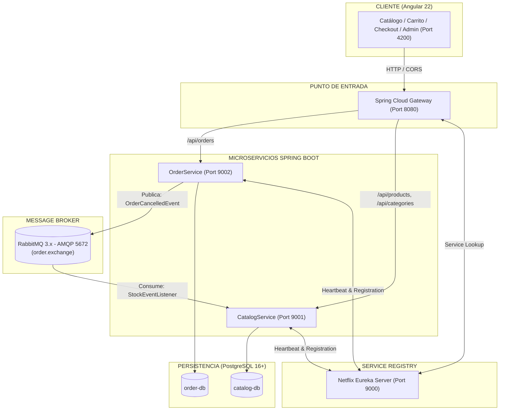

# 🛍️ EDELYX E-COMMERCE — Arquitectura Distribuida de Microservicios & Frontend Reactivo

> Plataforma completa de comercio electrónico desarrollada con una arquitectura desacoplada de nivel empresarial: **Backend en Microservicios con Spring Cloud, Event-Driven Architecture con RabbitMQ y bases de datos aisladas**, junto a un **Frontend SPA de alta gama en Angular 22 impulsado por Angular Signals, GSAP y Diseño Semántico**.

---

## 1. 📖 Explicación del Proyecto

**EDELYX E-COMMERCE** es una solución full-stack concebida para resolver los desafíos de escalabilidad, alta concurrencia, resiliencia y experiencia de usuario moderna en el comercio digital.

### Principios Fundamentales:
1. **Desacoplamiento Total:** El cliente web jamás se comunica directamente con las bases de datos ni con los microservicios individuales; todo el tráfico transcurre por un **API Gateway centralizado**.
2. **Patrón Database-per-Service:** Cada microservicio gestiona su propio esquema de base de datos relacional PostgreSQL de manera independiente (`catalog-db` y `order-db`), garantizando aislamiento de datos.
3. **Comunicación Asíncrona Orientada a Eventos:** Para operaciones críticas (como la compensación de inventario cuando un cliente cancela una orden), se utiliza **RabbitMQ** como message broker, evitando bloqueos síncronos HTTP.
4. **Reactividad Pura sin Sobrecarga en el Frontend:** La gestión de estado del carrito, los filtros y la reactividad visual se manejan con el nuevo paradigma de **Angular Signals** (`signal`, `computed`, `effect`), eliminando fugas de memoria y reduciendo drásticamente el boilerplate de librerías externas.
5. **Experiencia de Usuario de Primer Nivel:** Diseño estilo Amazon con tipografía editorial (*Teko* y *Eczar*), microinteracciones físicas calculadas con **GSAP** y degradación elegante ante caídas de servicios.



---

## 2. 🏗️ Estructura del Proyecto

El repositorio está organizado bajo un enfoque modular limpio que separa los microservicios de backend y la aplicación web frontend:

```text
EDELYX_ECOMMER/
├── EurekaServer/                           # Microservicio de Descubrimiento (Service Discovery)
│   ├── src/main/java/com/mx/eurekaserver/  # EurekaServerApplication (@EnableEurekaServer)
│   ├── src/main/resources/application.properties  # Puerto 9000, registro autónomo deshabilitado
│   └── pom.xml                             # Spring Cloud Netflix Eureka Server
│
├── gateway/                                # API Gateway Centralizado (Punto Único de Entrada)
│   ├── src/main/java/com/mx/orderservice/gateway/
│   │   └── GatewayApplication.java         # Configuración de CorsWebFilter reactivo
│   ├── src/main/resources/application.properties  # Puerto 8080, rutas hacia Catalog y Orders
│   └── pom.xml                             # Spring Cloud Gateway (Netty reactivo)
│
├── CatalogService/                         # Microservicio de Dominio: Catálogo & Inventario
│   ├── src/main/java/com/mx/catalogservice/
│   │   ├── config/RabbitMQConfig.java      # Configuración de colas y exchanges AMQP
│   │   ├── controller/                     # ProductsController, CategoryController
│   │   ├── entity/                         # Products, Category (JPA Entities)
│   │   ├── event/                          # OrderCancelledEvent, OrderCreatedEvent
│   │   ├── listener/StockEventListener.java# Consumidor de compensación de inventario
│   │   ├── model/                          # DTOs: ProductRequest, ProductResponse, etc.
│   │   ├── repository/                     # ProductsDao, CategoryDao
│   │   └── service/                        # ProductsImpl, CategoryImpl
│   ├── src/main/resources/
│   │   ├── application.properties          # Puerto 9001, conexión a catalog-db
│   │   └── db/migration/                   # Scripts Flyway (V1__init y V2__seed)
│   └── pom.xml                             # Spring Boot Web, Data JPA, AMQP, Flyway, Eureka Client
│
├── OrderService/                           # Microservicio de Dominio: Pedidos & Compras
│   ├── src/main/java/com/mx/orderservice/
│   │   ├── client/CatalogClient.java       # Cliente Feign/RestClient hacia Catálogo
│   │   ├── config/RabbitMQConfig.java      # Productor de eventos de órdenes
│   │   ├── controller/OrderController.java # Endpoints: POST, GET, PATCH /cancel
│   │   ├── entity/                         # Order, OrderItem
│   │   ├── model/                          # DTOs: OrderRequest, OrderResponse, OrderStatus
│   │   ├── repository/                     # OrderDao, OrderItemDao
│   │   └── service/OrderImpl.java          # Lógica de compra, folio ORD-XXXX y eventos
│   ├── src/main/resources/
│   │   ├── application.properties          # Puerto 9002, conexión a order-db
│   │   └── db/migration/                   # Scripts Flyway (V1__init_order_schema)
│   └── pom.xml                             # Spring Boot Web, Data JPA, AMQP, Flyway, Eureka Client
│
└── ECOMMER_WEB/                            # Frontend Web
    └── Edelyx_Ecommer/                     # Aplicación Angular 22
        ├── src/
        │   ├── app/
        │   │   ├── core/                   # Módulos singletons e infraestructura
        │   │   │   ├── layout/navbar/      # Navbar de 2 niveles con contador reactivo
        │   │   │   └── utils/http-error.util.ts # Manejador de errores amigables para el usuario
        │   │   ├── features/               # Módulos de dominio (Lazy-loaded)
        │   │   │   ├── catalog/            # Catálogo con filtros, precios y paginación
        │   │   │   ├── cart/
        │   │   │   │   ├── cart-drawer/    # Slide-over reactivo con microinteracciones GSAP
        │   │   │   │   └── checkout/       # Formulario de pago y confirmación de folio
        │   │   │   ├── orders/             # Búsqueda de recibo digital y cancelación
        │   │   │   └── admin/              # Panel de administración CRUD de categorías/productos
        │   │   ├── models/                 # Interfaces TypeScript espejo de DTOs Java
        │   │   ├── services/               # ProductService, CategoryService, CartService, OrderService
        │   │   ├── app.config.ts           # provideHttpClient, provideAnimationsAsync
        │   │   ├── app.routes.ts           # Enrutamiento con lazy loading
        │   │   └── app.ts / app.html       # Shell base con Footer oficial
        │   └── styles/
        │       └── design-system.css       # Sistema semántico de diseño (@layer components)
        ├── package.json                    # Angular 22, GSAP, PrimeNG, Tailwind CSS v3
        └── angular.json                    # Configuración de compilación Vite/esbuild
```

---

## 3. 🛠️ Tecnologías Usadas y Qué Resuelven

| Capa | Tecnología | Rol en la Arquitectura | ¿Qué problema resuelve? |
| :--- | :--- | :--- | :--- |
| **Backend** | **Java 21 LTS** | Lenguaje de desarrollo de backend | Proporciona tipado fuerte, rendimiento enterprise y Virtual Threads para alta concurrencia. |
| **Backend** | **Spring Boot 3.x** | Framework de microservicios | Simplifica el desarrollo transaccional de APIs REST, repositorios JPA y configuración de beans. |
| **Backend** | **Spring Cloud Gateway** | API Gateway Reactivo (Netty) | Unifica el punto de acceso, gestiona políticas de CORS globales y abstrae los puertos internos de los microservicios. |
| **Backend** | **Netflix Eureka** | Service Discovery | Permite el registro dinámico de instancias para que el Gateway las localice sin necesidad de IPs estáticas fijas. |
| **Backend** | **RabbitMQ 3.x** | Message Broker Asíncrono | Desacopla la lógica de pedidos de la de catálogo. Permite compensar inventario en caso de cancelación sin dependencias síncronas. |
| **Backend** | **PostgreSQL 16+** | Base de Datos Relacional | Garantiza persistencia ACID con bases de datos completamente independientes para Catálogo y Órdenes (*Database-per-Service*). |
| **Backend** | **Flyway** | Versionado de BD | Permite la inicialización y migración automática del esquema y los datos iniciales (*seeding*) de forma reproducible. |
| **Frontend** | **Angular 22** | Framework SPA de UI | Ofrece arquitectura basada en componentes independientes (*Standalone Components*), control flow moderno (`@if`, `@for`) y compilación esbuild. |
| **Frontend** | **Angular Signals** | Gestión de Estado Reactivo | Reactividad granular directa (`signal`, `computed`, `effect`) sin suscripciones manuales de RxJS ni complejidad innecesaria de NgRx. |
| **Frontend** | **GSAP 3 (GreenSock)** | Motor de Animaciones Físicas | Proporciona microinteracciones fluidas con físicas reales (`back.out`) en el badge del carrito y aperturas suaves del drawer. |
| **Frontend** | **Tailwind CSS v3** | Sistema de Estilizado | Configurado con arquitectura semántica en `@layer components` para erradicar la sopa de clases utilitarias en el HTML. |
| **Frontend** | **PrimeNG 21 + PrimeIcons** | Componentes UI Auxiliares | Aporta diálogos modales, toasts no intrusivos e iconografía vectorial coherente. |

---

## 4. 🚨 Errores Más Importantes y Cómo los Solucionamos

### 1. Saturación de Memoria RAM en Entornos de Desarrollo (Laptops de 8 GB)
- **Problema:** Al ejecutar simultáneamente Eureka, Gateway, CatalogService, OrderService, PostgreSQL, RabbitMQ y Angular, la memoria RAM superaba los 7.5 GB, provocando congelamientos por el recolector de basura de la JVM.
- **Solución:** Se implementó una política estricta de asignación de memoria heap en Maven y Spring Boot:
  ```bash
  MAVEN_OPTS="-Xmx96m" ./mvnw spring-boot:run -Dspring-boot.run.jvmArguments="-Xmx180m"
  ```
  Esto redujo el consumo global a menos de 4.8 GB totales de RAM, manteniendo el sistema rápido y estable.

### 2. Bloqueo de CORS entre Angular (`:4200`) y el API Gateway (`:8080`)
- **Problema:** Las peticiones HTTP desde el navegador eran rechazadas por políticas de Same-Origin en peticiones preflight `OPTIONS` y verbos no estándar (`PATCH` para cancelaciones).
- **Solución:** Se integró un `CorsWebFilter` reactivo en `GatewayApplication.java` configurado para aceptar orígenes de desarrollo, todos los encabezados y los métodos `GET, POST, PUT, DELETE, PATCH, OPTIONS`.

### 3. Compensación de Inventario en Cancelaciones sin Acoplamiento Síncrono
- **Problema:** Si un usuario cancelaba una orden mientras `CatalogService` estaba ocupado o reiniciándose, una llamada HTTP síncrona fallaría y el stock no se devolvería al inventario.
- **Solución:** Se diseñó una arquitectura basada en eventos con **RabbitMQ**:
  - `OrderService` emite un evento `OrderCancelledEvent` a la cola `order.cancelled.queue`.
  - `CatalogService` consume el mensaje mediante un `@RabbitListener` y ejecuta una transacción de actualización atómica en PostgreSQL devolviendo las unidades exactas.

### 4. Filtrado Dinámico de Productos por Categoría
- **Problema:** El backend retornaba la página completa de productos sin filtrar por categoría cuando el usuario navegaba por las pestañas del navbar.
- **Solución:** En lugar de recargar la página, se implementó en `catalog.component.ts` una señal computada `products = computed(...)` vinculada a `queryParams` que filtra de forma instantánea en memoria sin generar peticiones HTTP innecesarias.

### 5. Fuga de Mensajes Técnicos de Error al Usuario Final
- **Problema:** Durante pruebas de resiliencia (al detener un microservicio), la interfaz mostraba mensajes técnicos como *"Verifica que el API Gateway (8080) esté activo"*, inapropiados para clientes.
- **Solución:** Se creó el utilitario centralizado `http-error.util.ts` que intercepta errores con código `0`, `502`, `503`, `504` o respuestas HTML de error, traduciéndolos a copys amigables como *"El catálogo de productos no se encuentra disponible temporalmente. Por favor, intenta de nuevo en unos momentos."*.

### 6. Desincronización de Caché de Vite en Angular (Error 504 Outdated Optimize Dep)
- **Problema:** Al montarse el proyecto sobre particiones externas, la caché interna de Vite en `.angular/cache` quedaba con inodos corruptos tras desconexiones, provocando que Angular bloqueara módulos esenciales.
- **Solución:** Se incorporó el procedimiento de limpieza y reinicio rápido eliminando `.angular/cache`, restableciendo los bundles en menos de 2 segundos.

---

## 5. 📝 Resumen del Proyecto

**EDELYX E-COMMERCE** representa la materialización de un sistema moderno, resiliente y mantenible que integra lo mejor de los dos mundos:

- **En el Backend:** La solidez y modularidad del ecosistema **Spring Cloud**. Cada dominio de negocio (Catálogo y Órdenes) es independiente, transaccional y escalable de forma horizontal. La adopción de **RabbitMQ** asegura que eventos críticos nunca se pierdan, y el **Gateway** mantiene una barrera de seguridad limpia entre el exterior y los microservicios.
- **En el Frontend:** La eficiencia de **Angular 22** con **Signals**, que ofrece una experiencia reactiva instantánea para el cliente: el carrito se actualiza y persiste en `localStorage` sin esperas, los botones validan stock en tiempo real y las microanimaciones de **GSAP** aportan una sensación visual fluida y pulida.
- **En la Experiencia Global:** El sistema está preparado para la vida real: soporta caídas temporales de servicios con autorecuperación mediante botones de reintento, protege la identidad de sus componentes internos con mensajes orientados al usuario y cuenta con una base de código limpia y documentada lista para evolucionar a producción.

---

*Desarrollado con pasión para el proyecto EDELYX.*
